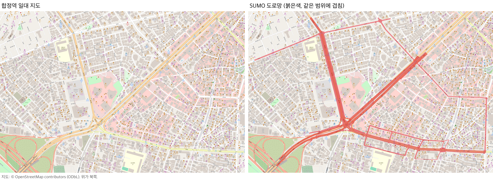
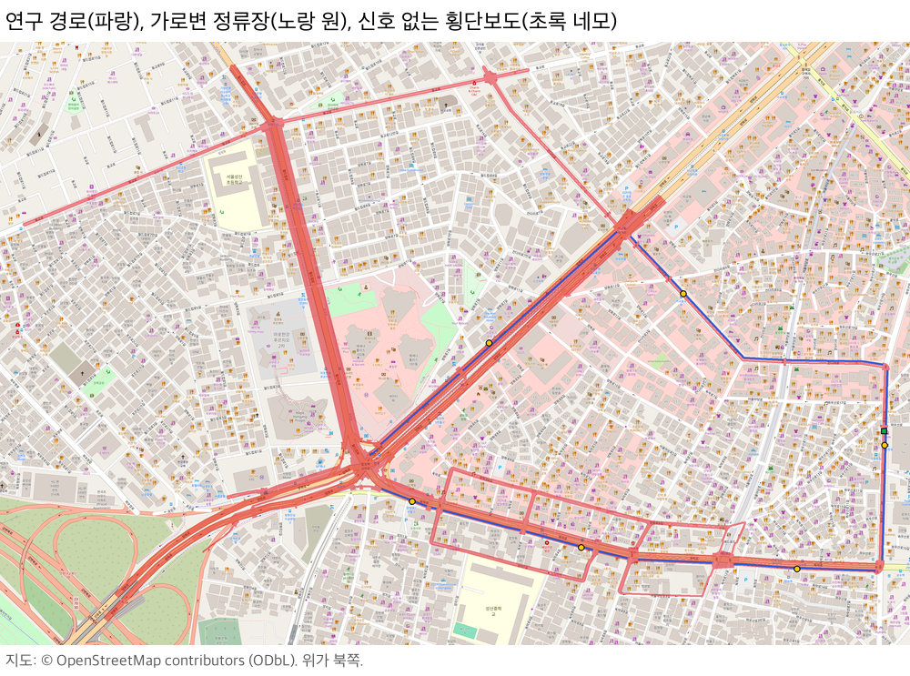
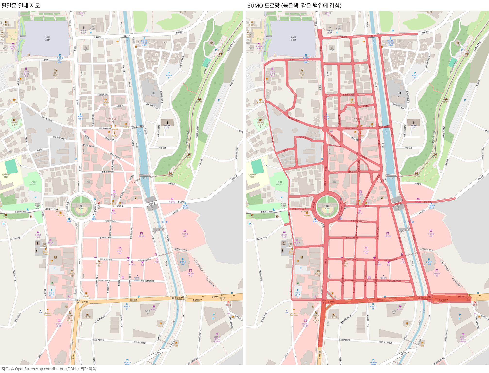

# 합정역 자율주행버스 도로 (SUMO)

서울 합정역 일대 실제 도로를 SUMO로 옮긴 팀 프로젝트용 도로다. 연구 주제는 자율주행버스가 일반 차로의 가로변 정류장을 오가며 겪는 상호작용(정류장 출발 후 재합류, 정류장 직후 좌회전 차로 변경, 신호 없는 횡단보도 등)이다. 도로망은 서예인이 만들었고, 실제 지도와 대조해 고친 내용은 [maps/hapjeong/README.md](maps/hapjeong/README.md)에 있다.



연구 경로는 합정역에서 독막로, 상수역, 와우산로, 잔다리로, 홍대입구역 교차로를 돌아 합정역으로 오는 순환 경로다(`bus_loop`, 2,052m). 경로 위에 실제 위치의 가로변 정류장 6곳과 신호 없는 횡단보도 1곳이 있다. 독막로 양쪽 골목은 끊긴 곳 없이 이어져 있고, 그중 두 곳은 독막로에 신호 없이 합류한다.



## 설치

Python 3.10과 SUMO 1.27.1에서 확인했다. SUMO는 따로 설치하고 `SUMO_HOME`을 설정한다. 패키지는 SUMO를 쓸 가상환경 하나에 설치한다.

```bash
git clone https://github.com/Twave1717/Artificial-Intelligence-and-Control-for-Autonomous-Driving.git
cd Artificial-Intelligence-and-Control-for-Autonomous-Driving
conda create -n sumo-rl python=3.10
conda activate sumo-rl
python -m pip install -r requirements.txt
```

`ModuleNotFoundError: No module named 'sumolib'`가 나오면 패키지를 설치하지 않은 환경(예: conda `base`)에서 실행한 것이다. `conda activate sumo-rl` 뒤에 다시 실행한다.

도로를 읽을 때 `network.net.xml`의 sha256을 검사한다. `.gitattributes`가 XML의 줄바꿈을 바꾸지 않게 하므로 Windows에서도 git으로 받으면 된다.

## 도로 보기

```bash
python view_road.py --map hapjeong                    # sumo-gui로 연다. ▶를 눌러 재생한다
python view_road.py --map hapjeong --scenario busy    # 교통량: quiet, baseline(기본), busy
python view_road.py --map hapjeong --netedit          # netedit로 도로 구조만 본다
```

`--map`을 생략하면 팔달문 도로가 열린다(부록).

## 도로 고치기와 검증

합정역 실행 도로망은 서예인의 원본(`maps/hapjeong/source/network.base.net.xml`)에 `scripts/build_hapjeong.py`가 수정을 적용해 만든다. 고친 뒤 다시 만들고 검증한다.

```bash
python scripts/build_hapjeong.py
python scripts/validate_road.py --map hapjeong --out maps/hapjeong/references/stability_validation.json
```

같은 입력이면 같은 파일이 나온다. 가장 최근 검증(seed 0·7·42 × quiet·baseline·busy, 1,800초)에서 순간이동은 0이고, 충돌은 quiet 2회에서 4번 났다. 모두 J42에서 우회전하는 차와 횡단보도 보행자의 충돌이고, 자세한 내용은 [maps/hapjeong/README.md](maps/hapjeong/README.md#알려진-현상)에 있다.

## 학습, 평가, 데이터 수집

학습 환경은 아직 팔달문 도로에서만 돈다. 합정역은 대부분 도로의 0번 차로가 인도라서, 차로 번호를 관측으로 쓰는 지금의 학습 환경이 틀린 값을 읽는다. 합정역으로 학습을 시작하면 이유를 보여 주고 멈춘다. 학습 쪽 사용법은 [부록 B](#부록-b-학습-평가-데이터-수집)에 있다.

## 함께 작업하기

`main`에 바로 push하지 않는다. 브랜치를 만들어 작업하고 GitHub에서 PR을 열어 합친다.

```bash
git switch -c <브랜치 이름>
git push -u origin <브랜치 이름>
```

도로를 고쳤다면 PR을 열기 전에 `scripts/validate_road.py`를 돌려 `통과`를 확인한다.

## 출처

도로 자료와 README의 지도 그림은 © OpenStreetMap contributors, ODbL 1.0이다.

## 부록 A. 팔달문 도로

수원 팔달문 원형 차도를 중심으로 정조로, 행궁로, 수원천로 양쪽, 창룡대로, 중부대로와 그 사이 골목 중 팀이 지도에 표시한 도로만 남겼다. 신호는 없다. 지역 간 일관성 확인용 2차 대상지이고, 지금 학습 환경의 기본 지도다(`--map` 생략).

- 도로 ID, 경로, 정류장: [maps/paldalmun/README.md](maps/paldalmun/README.md)
- 도로를 이렇게 고른 이유와 측정 결과: [maps/paldalmun/DESIGN.md](maps/paldalmun/DESIGN.md)



남길 도로는 `maps/paldalmun/source/drawn_edges.json`의 목록이고, ego 경로는 `scripts/build_road.py`의 `ROUTES`다.

```bash
python view_road.py
python scripts/build_road.py
python scripts/validate_road.py --seeds 0 7 42 --scenarios quiet baseline busy --seconds 1800 --out maps/paldalmun/references/stability_validation.json
```

가장 최근 검증에서는 45회 모두 통과했고, 배경 차량의 충돌과 순간이동은 0이었다.

## 부록 B. 학습, 평가, 데이터 수집

```bash
python train.py --scenario baseline --seed 42
python test.py MODEL --nogui --episodes 10
python collect_pomdp_data.py --policy route-follow --episodes 10 --out-dir data/paldalmun --name run1
python train_bc.py --data data/paldalmun/run1.npz --epochs 50
```

- ego의 기본 경로는 팔달문 `r0`다. 다른 경로는 `--ego-route s_left_turn`처럼 고른다.
- ego는 0.5초마다 행동을 정하고 SUMO는 0.1초 간격으로 계산한다. 에피소드는 최대 1,000번 결정(500초)이다.
- `test.py`는 같은 폴더에 `run_config.json`이 있는 모델만 평가한다. 옵션을 주지 않으면 학습 때의 설정으로 평가한다.

수업 원본 코드와 다르게 동작하는 부분은 다음과 같다.

- SUMO 계산 간격 0.1초. 0.5초로 계산하면 교차로와 합류부의 대기열이 달라진다.
- ego 안전 보조가 켜져 있다(`speed_mode=31`, `lane_change_mode=512`). 끌지는 팀이 정한다. 값은 `env/road_config.py`의 `_EGO`에 있다.
- ego를 넣기 전에 배경 교통을 180초 흘린다.
- `blocked_penalty`가 0이다. 교차로에서 양보하며 기다리는 것까지 벌점을 받지 않게 했다.
- 차로 유지 행동은 SUMO에 명령을 보내지 않는다. 차선 변경 벌점과 `lane_changes`는 실제 차선 이동을 센다.
- 관측의 차로 연결성은 ego 경로 방향으로 이어지는 거리만 센다.
- PPO의 GAE는 시간 초과에서도 끊는다. ego가 300초 서 있다 순간이동하면 에피소드는 `teleport`로 끝난다.
