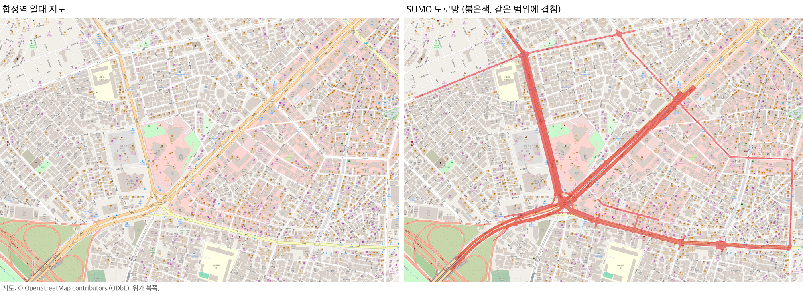
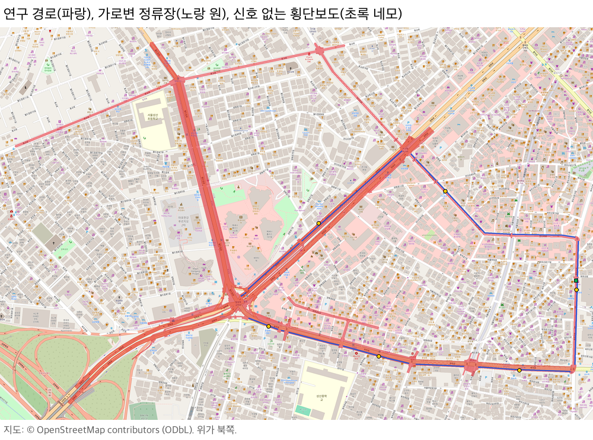

# 합정역 도로

합정역 일대 실제 도로를 SUMO로 옮긴 도로망이다. 원본 도로망은 서예인이 OSM을 바탕으로 만들었고(`합정역` 브랜치 `ec6fbf6`), `scripts/build_hapjeong.py`가 실제 지도와 대조해 고친 내용을 적용해 실행 도로망을 만든다.

## 연구 시나리오와 도로

연구 경로 `bus_loop`(2,061m)는 서예인이 제안한 순환 경로다. 합정역에서 독막로를 따라 상수역까지 가서 와우산로로 좌회전하고, 잔다리로를 지나 홍대입구역 교차로에서 양화로로 들어와 합정역으로 돌아온다.

| 시나리오 | 도로에 있는 것 | 위치 |
|---|---|---|
| S1 정류장 출발 후 재합류 | 가로변 정류장 합정역7번출구(14-119) | 독막로 동행 `R69` |
| S2 정류장 직후 좌회전 연속 차선변경 | 정류장 상수역에서 와우산로 좌회전까지 116m, 4차로 | 독막로 `R111` → `R112` |
| S3 정류장 접근 연속 차선변경 | 가로변 정류장 성산중학교, 극동방송, 서교동교회, 합정역(14-219) | `R71`, `R112`, `-R96`, `R54a` |
| S5 골목 차량 끼어들기 | 이어진 골목 세 개(양화로6길 서쪽·동쪽, 독막로3길)에서 나온 차가 독막로에 신호 없이 합류한다. 신호 교차로의 골목 토막에서도 차가 나온다 | 독막로3길 합류점 `X_dongmak3`(합정역 쪽에서 약 240m), J8, J23 |
| S6 신호 없는 횡단보도 | 와우산로 중간 횡단보도. 차가 보행자에게 양보한다 | 극동방송 정류장 44m 뒤 |
| S4 정류장 앞 정차 차량 | 도로에는 따로 없다. 시나리오 쪽 이벤트다 | |

정류장은 Overpass(OSM)에서 받은 실제 정류장 점을 가장 바깥 차도 차로에 25m 길이로 놓았다. 점과 차로의 거리는 0.6~5.2m이고, 상수역만 14.1m다(인도 위 승강장 점). `map.json`의 `bus_stops`에 OSM 노드 id와 거리가 있다. 양화로 중앙버스차로 정류장 2곳(`source/stops.add.xml`)은 원본 그대로다.

## 이어진 골목

독막로 북쪽의 실제 골목 세 개를 OSM 좌표 그대로 1차로 양방향, 30km/h로 붙였다. 양화로6길은 독막로 북쪽 약 50m에서 독막로와 나란히 달리는 뒷골목이고, 독막로3길이 그 가운데(`Y2`)에서 남쪽으로 내려와 독막로에 신호 없이 합류한다. 양화로6길 양 끝은 도로망 경계라 배경 골목 차(baseline 시간당 약 73대)가 여기서 나와 독막로로 들어간다.

| 골목 | OSM | 도로 id |
|---|---|---|
| 양화로6길 서쪽 | `172603991` | `G2`, `-G2` |
| 양화로6길 동쪽 | `172603991` | `G2e`, `-G2e` |
| 독막로3길 | `172603989` | `G3`, `-G3` |

골목 끝은 배경 차량의 출발지로만 쓴다. 도착지로도 쓰면 모든 진입로가 차를 똑같이 나눠 보내 골목으로 시간당 약 160대가 몰렸고, 합정역 쪽 독막로가 막혔다. J8 북쪽의 서비스도로로 골목을 J8 신호 교차로에 잇는 안도 시험했지만, J8에서 골목으로 꺾는 차가 늘어 충돌과 순간이동이 나서 잇지 않았다.

## 원본에서 고친 것

| 고친 것 | 이유 | 근거 |
|---|---|---|
| 제한속도 100·80km/h → 간선 50, 연결로와 이름이 "~길"인 이면도로 30km/h | 원본은 양화로·월드컵로·독막로 일부가 100km/h였다. 50km/h 골목 토막 끝에서 출발한 차가 바로 앞 횡단보도에서 보행자를 쳤다 | 안전속도 5030, OSM 독막로 maxspeed 50, `maps/paldalmun/source/speed_defaults.json` |
| J52·J56·J58(어울마당로·레드로드)을 한 교차로로 합치고 횡단보도 6개를 다시 놓음 | 11m 간격 세 교차로 사이 4m 구간에 차가 들어가지 못하고 교차로 안에 서 있다가 부딪혔다. 원본 충돌이 J58에 몰렸다 | 합친 뒤 이곳 충돌 0 |
| J56 신호 프로그램을 빼고 합친 교차로는 기본 신호 | 합치면서 연결 번호가 바뀌었다 | |
| J1 신호에서 중앙버스차로가 일반 차로로 합류하는 연결 2개를 양보 녹색(g)으로 | 같은 차로로 우선 녹색 두 개가 동시에 들어갔다 | SUMO 경고 "Unsafe green phase" |
| J3(연결로 R66이 양화로에 합류) 지퍼 합류 → 연결로 양보 | busy에서 합류부 정체가 풀리지 않아 순간이동이 났다 | 바꾼 뒤 순간이동 0 |
| 배경 차량 baseline 합계 900대/시간 | 50km/h에서 1,320대(팔달문 규칙 그대로)는 평균 주행 대수가 두 배가 되며 교차로 안까지 정체가 이어졌다 | 원본 생성기 설정의 `vehs_per_hour` 900 |
| 보행자 경로 다시 생성(시간당 600명, 최소 150m, seed 42) | 교차로를 합치면 원본 보행자 경로가 지나던 도로가 사라진다 | 원본 생성기 설정과 같은 값 |

시도했다가 되돌린 것도 있다. 골목 토막을 배경 차량의 도착지에서 빼면 순간이동이 15번 났고, 그중 8번은 J8의 골목 차가 신호에서 빠져나가지 못한 것이었다. 그래서 골목은 출발지와 도착지 모두로 쓴다. 결정 과정은 로컬 기록 `.audit/hapjeong-road.tsv`에 있다.

## 검증

`references/stability_validation.json`: seed 0·7·42 × quiet·baseline·busy, 1,800초. 순간이동은 9회 모두 0이다. 충돌은 baseline 3회에서 모두 4번 났고(아래 알려진 현상), quiet·busy 6회는 0이다. 도로 안 평균 차량 수는 quiet 약 16대, baseline 약 34대, busy 약 44대다.

원본 도로망은 같은 조건에서 충돌 13번, 순간이동 4번이었다. 골목을 넣기 전의 수정 도로망은 9회 모두 충돌 0, 순간이동 0이었다(커밋 `1c9e8c3`).

## 알려진 현상

- 신호 교차로에서 꺾는 차와 횡단보도 보행자의 충돌. 검증 9회 중 4번(J8 3번, J1 1번), seed 1~6 추가 12회 중 3번(J8)이다. J8의 3번은 모두 독막로2길(`-R117`)에서 나와 합정역 쪽으로 좌회전한 차가 서쪽 횡단보도 위에 멈춰 섰을 때, 녹색으로 건너던 보행자가 부딪힌 것이다. J8 신호는 골목 녹색 단계(20초)에 그 횡단보도도 녹색이라 꺾는 차가 보행자에게 양보해야 하는 구조다. 골목을 넣기 전에도 J23에서 같은 종류의 충돌이 났으니(추가 seed 1번), 골목이 아니라 교통 흐름의 시각에 따라 드러나는 기존 문제로 본다(추정). 없애려면 J8 신호에서 골목 회전과 그 횡단보도를 시간으로 나눠야 한다.
- 학습 환경에서는 아직 쓸 수 없다(`map.json`의 `trainable`). 일반 도로 대부분의 0번 차로가 인도다.

## 파일

| 파일 | 내용 |
|---|---|
| `map.json` | 연구 경로, 가로변 정류장, 배경 교통, 부속 파일 목록. `scripts/build_hapjeong.py`가 만든다 |
| `source/network.base.net.xml`, `source/signals.base.add.xml` | 서예인의 원본 도로망과 신호 프로그램. 빌드의 입력이다 |
| `source/network.net.xml`, `source/signals.add.xml`, `source/pedestrians.rou.xml` | 빌드가 만든 실행 도로망, 신호 프로그램, 보행자 경로 |
| `source/islands.add.xml`, `source/seams.add.xml` | 교통섬과 차로 이음선 표시 |
| `source/stops.add.xml` | 양화로 중앙버스차로 정류장 2곳 |
| `source/context.add.xml` | 건물·녹지 외곽선. 화면 표시용 |
| `source/area.osm.xml` | OSM 원자료 (© OpenStreetMap contributors, ODbL 1.0) |
| `generator/` | 원본 도로망을 만든 생성기(`osm_builder.py`와 그때의 `road_builder.py`, `road_config.py`). 수업 원본 코드 구조를 전제로 해서 이 저장소에서는 그대로 실행되지 않는다 |
| `references/hapjeong_road.png`, `references/hapjeong_scenario.png` | 지도 대조 그림과 연구 경로 그림 |
| `references/stability_validation.json` | `scripts/validate_road.py --map hapjeong`의 결과 |
