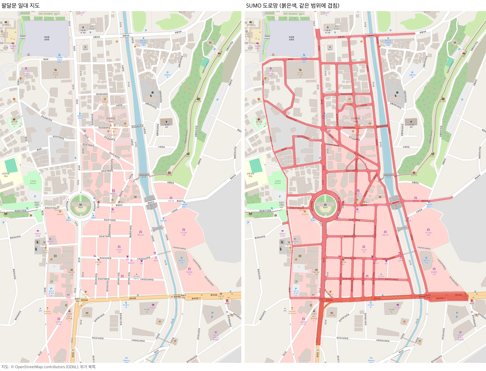

# 팔달문 도로 참조

도로망의 구성과 ID를 정리한다. 모든 값의 원본은 `map.json`이고, 도로를 이렇게 고른 이유는 [DESIGN.md](DESIGN.md)에 있다.

## 도로망

| 항목 | 값 |
|---|---|
| 실행 도로망 | `source/network.net.xml`. 일반 도로 구간 395개, 교차로 155개 |
| 범위 | `source/drawn_edges.json`의 도로. 팀이 지도에 펜으로 표시한 도로다. 전체 도로망에 없던 OSM service 길 4개는 빌드가 붙인다 |
| 주요 도로 | 정조로, 행궁로, 수원천로(양쪽 둑), 창룡대로, 중부대로, 팔달문로(수원천 동쪽) |
| 신호 | 없음. 모든 교차로가 무신호 우선순위 교차로 |
| 좌표 | 교차로 노드는 OSM 좌표에서 1cm 안. 원형 차도 밖의 도로 중심선은 OSM 도로선에서 1mm 안 |
| 원형 차도 | 4차로. 구간 `1197050172#0`, `#1`, `#2`, `38315385#0`, `#1`, `#2`. 진입은 남·북 정조로, 동쪽 팔달문로, 서쪽 정조로777번길, 북동 골목 `-59150681#0` |
| 제한속도 | 13.89m/s(50km/h) 또는 8.33m/s(30km/h) |
| 경계 | 진입로 6개, 진출로 6개 |

## ego 경로

`map.json`의 `routes`다. ego는 기본으로 `r0`를 달리고, 다른 경로는 `--ego-route`로 고른다.

| 경로 | 설명 | 길이 |
|---|---|---:|
| `r0` | 남쪽 정조로 → 중부대로 교차로 직진 → 골목 합류 구간 → 팔달문 남→동→북 → 북쪽 정조로 | 564m |
| `s_alley_merge_north` | 동쪽 골목 정조로764번길 → 정조로 북행 2차로에 우회전 합류 → 팔달문 진입 → 북쪽 정조로 | 430m |
| `s_left_turn` | 팔달문 남쪽 출구 → 정조로 남행 2차로 → 중부대로 교차로 좌회전 → 중부대로 동쪽 | 288m |
| `s_alley_left` | 서쪽 골목 → 정조로 남행에 우회전 합류 → 왼쪽 차로 변경 → 중부대로 교차로 좌회전 → 중부대로 동쪽 | 327m |

## 배경 교통

`map.json`의 `flows`다. 경계 진입로마다 baseline 유입량을 정하고, 되돌아가는 진출로를 뺀 나머지 진출로에 같은 비율로 나눴다. 경로는 SUMO가 그때그때 가장 빠른 길로 고른다. quiet는 0.5배, busy는 1.25배다.

| 진입로 | 도로 | baseline 유입(대/시간) |
|---|---|---:|
| `-1201062230#0` | 북쪽 정조로 | 300 |
| `171323844#2` | 남쪽 정조로 | 300 |
| `842287514#2` | 동쪽 중부대로 | 300 |
| `-666442990#1` | 동쪽 창룡대로 | 150 |
| `537044581#0` | 동쪽 팔달문로 | 150 |
| `537277446#2` | 서쪽 행궁로62번길 | 40 |

규칙은 `scripts/build_road.py`의 `ARTERIAL_PER_LANE`(50km/h 도로 차로당 150대, 2차로까지)과 `ALLEY`(30km/h 도로 40대)다.

## 시나리오 구역

`map.json`의 `design.zones`다. 차로 번호는 오른쪽 끝 차로가 0이다.

| 구역 | 도로 ID | 내용 |
|---|---|---|
| 북행 골목 합류 | `-59150694#1` → `37394478#4` | 정조로764번길에서 우회전. 골목 쪽이 양보. 원형 차도 진입 약 60m 앞 |
| 남행 골목 합류 | `-40197651#1` → `-37394478#5` | 서쪽 골목에서 우회전. 골목 쪽이 양보. 중부대로 교차로까지 약 150m |
| 좌회전 | `-37394478#0` 차로 1 → `171323839` | 교차로 노드 `414688141`. 왼쪽 차로(1)에서만 좌회전. 목적지 `1224432174#5` |

## 정류장

OSM 정류장 노드를 바깥 차로에 투영했다. 버스 운행은 없고 위치만 있다.

| ID | 이름 | 차선 | 위치 |
|---|---|---|---|
| `osm_stop_6210299488` | 팔달문(03056) | `1197050172#2_0` | 1~26m |
| `osm_stop_9360442452` | 팔달문.이안과(03054) | `1176921670#2_0` | 19.11~44.11m |

## 실제 신호 위치

실행 도로망에는 신호가 없다. 신호 담당자가 쓸 실제 위치는 `source/structure_patch.json`의 `signal_locations`에 있다.

## 파일

| 파일 | 내용 |
|---|---|
| `map.json` | ego 경로, 배경 교통, 정류장, 시나리오 구역, 도로망 sha256 |
| `DESIGN.md` | 도로를 고른 방법과 측정 결과 |
| `source/drawn_edges.json` | 실행 도로망에 남길 도로 목록과 고른 방법 |
| `source/area.osm.xml` | OSM 원자료 (© OpenStreetMap contributors, ODbL 1.0) |
| `source/network.full.net.xml` | 이전 수입 단계에서 만든 팔달문 일대 전체 도로망(778구간). 빌드의 입력이다 |
| `source/network.net.xml` | 실행 도로망 |
| `source/structure_patch.json` | 신호 제거와 분할점 병합 규칙, 실제 신호 위치 |
| `source/overrides.json`, `source/simulation_overrides.json`, `source/speed_defaults.json` | 전체 도로망을 수입할 때 쓴 차로 수·제한속도 가정과 근거 |
| `source/context.add.xml`, `source/context.metadata.json` | 건물·녹지 외곽선. 화면 표시용 |
| `references/paldalmun_road.png` | OpenStreetMap 지도와 실행 도로망을 같은 범위에 겹친 그림 |
| `references/comparison.jpg`, `references/focal/comparison.jpg` | Esri 항공사진과 이전 범위 도로망의 대조. 원형 차도 차로 수의 근거다(`source/overrides.json`). Esri 약관 때문에 저장소에는 올리지 않았다. 항공영상의 범위와 받는 주소는 아래 메타데이터에 있다 |
| `references/satellite.metadata.json`, `references/focal/satellite.metadata.json` | 항공영상 타일의 출처와 범위 |
| `references/stability_validation.json` | `scripts/validate_road.py`의 결과 |
